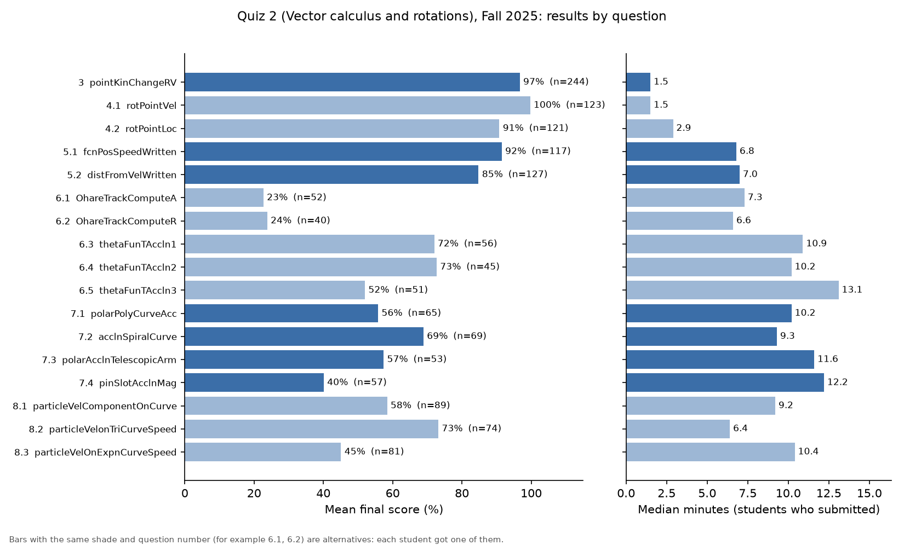

# Quiz 2 (Vector calculus and rotations): diagnosis
2026-11-06 · TAM 212, Fall 2025 (main), compared with Fall 2024, Spring 2025, Spring 2026 and Fall 2026 · PrairieLearn production database, read-only, aggregate queries

## Bottom line
- **Fall 2025 was not fair for question 6.** The two O'Hare track alternatives (6.1 `OhareTrackComputeA`, 6.2 `OhareTrackComputeR`) averaged 23% against 52–73% for the three `thetaFunTAccln` alternatives. The 92 of 244 students (38%) who drew an O'Hare question got about **6.3 fewer points out of 100** on average. No staff score changes were made. **This is already fixed:** both O'Hare questions were removed from Spring 2026 onward. Whether to adjust Fall 2025 grades is up to you.
- **Question 8 is still uneven, and the "easy" alternative is easy by accident.** In about half the variants of 8.2 `particleVelonTriCurveSpeed`, the point sits where the slope is zero, so the correct answer is v_y = 0. Students score 96–99% on those variants and 40–55% on the rest. Change the generator so the point never lands on a zero slope.
- **Question 7: 7.4 `pinSlotAcclnMag` is the hardest draw and 7.2 `acclnSpiralCurve` the easiest** in all five offerings (Fall 2025: 40% vs 69%). 7.3 and 7.4 give the angular acceleration in words ("decreasing at the rate of …"), and a common first answer ignores the sign. 7.2 has no angular acceleration at all. Make the four alternatives ask for the same steps.
- **Question 6.5 `thetaFunTAccln3` scores 11–20 points lower than 6.3/6.4 in every offering.** It is the only one where the angular velocity changes over time, although the other two are titled "time dependent angular velocity" too. Make the three match. This matters more now that it is one of only three alternatives.
- **Question 5 (written, manually graded):** the alternatives are close (within 1.3 points of 100), but graders' average scores on the same question differ by up to 20 percentage points. Calibrate graders before grading.

Taken together, the luck of the draw in questions 6–8 was worth about **15 points out of 100** between the best and worst set of alternatives in Fall 2025 (expected values). In Fall 2026 it was about **9 points**.

## Scope

| Course instance | Quiz 2 dates | Students | Notes |
| --- | --- | --- | --- |
| **Fall 2025** (main) | 2025-09-30 – 10-03 | 244 | Current structure except Q6 still had both O'Hare alternatives. Q5 manually graded (new this term). |
| Fall 2024 | 2024-10-01 – 10-04 | 200 | Same as Fall 2025, but Q5 was auto-graded (`fcnPosSpeed`, `distFromVel`). |
| Spring 2025 | 2025-02-25 – 02-28 | 474 | Same as Fall 2024. |
| Spring 2026 | 2026-02-24 – 03-01 | 589 | O'Hare alternatives removed from Q6 (now 6.1–6.3 are `thetaFunTAccln1/2/3`). Q5 manually graded, rubric reweighted. |
| Fall 2026 (current definition) | 2026-09-29 – 10-11 | 326 | Same as Spring 2026; rubric adds "Notation issues". Already given. |

- Total points are 100: Q3 20, Q4 20, Q5 20, Q6 15, Q7 15, Q8 10 (Q1–2 are 0-point Python workspace and tutorial). Auto-graded questions allow retries for slightly fewer points.
- The quiz runs in PrairieTest, so its length isn't stored in PrairieLearn. 90% of students finish within 49.6–49.9 minutes, so I treat it as **about 50 minutes (inferred)**.
- I took "last fall" to mean **Fall 2025**. Fall 2026 has also run on the current definition, so it's shown wherever fixes apply.
- Excluded: the retake (`quiz02r`, different questions), the practice quiz, summer offerings (different questions), and staff/test instances.
- Alternatives were drawn evenly across exam days in Fall 2025 and Fall 2026. Students who drew each alternative scored about the same on question 3, which everyone got (18.7–19.9 of 20), so the groups were comparable.

## Results at a glance

Fall 2025. Points are mean points earned; "Δ" is points out of 100 compared with the average of the other alternatives for that question.

| # | QID | Pts | n | Mean score | Full credit | No submission | Median min | Δ pts /100 |
| --- | --- | --- | --- | --- | --- | --- | --- | --- |
| 3 | `pointKinChangeRV` | 20 | 244 | 97% | 81% | 0% | 1.5 | – |
| 4.1 | `rotPointVel` | 20 | 123 | 100% | 94% | 0% | 1.5 | +1.8 |
| 4.2 | `rotPointLoc` | 20 | 121 | 91% | 72% | 0% | 2.9 | −1.8 |
| 5.1 | `fcnPosSpeedWritten` | 20 | 117 | 92% | 70% | 0% | 6.8 | +1.3 |
| 5.2 | `distFromVelWritten` | 20 | 127 | 85% | 67% | 1% | 7.0 | −1.3 |
| 6.1 | `OhareTrackComputeA` | 15 | 52 | **23%** | 17% | **23%** | 7.3 | **−4.9** |
| 6.2 | `OhareTrackComputeR` | 15 | 40 | **24%** | 13% | 10% | 6.6 | **−4.6** |
| 6.3 | `thetaFunTAccln1` | 15 | 56 | 72% | 38% | 2% | 10.9 | +4.4 |
| 6.4 | `thetaFunTAccln2` | 15 | 45 | 73% | 47% | 0% | 10.2 | +4.5 |
| 6.5 | `thetaFunTAccln3` | 15 | 51 | 52% | 22% | 4% | 13.1 | +0.6 |
| 7.1 | `polarPolyCurveAcc` | 15 | 65 | 56% | 39% | 5% | 10.2 | +0.1 |
| 7.2 | `acclnSpiralCurve` | 15 | 69 | 69% | 38% | 1% | 9.3 | +2.7 |
| 7.3 | `polarAcclnTelescopicArm` | 15 | 53 | 57% | 21% | 0% | 11.6 | +0.4 |
| 7.4 | `pinSlotAcclnMag` | 15 | 57 | **40%** | 14% | 2% | 12.2 | **−3.1** |
| 8.1 | `particleVelComponentOnCurve` | 10 | 89 | 58% | 18% | 1% | 9.2 | −0.1 |
| 8.2 | `particleVelonTriCurveSpeed` | 10 | 74 | 73% | 51% | 0% | 6.4 | +2.2 |
| 8.3 | `particleVelOnExpnCurveSpeed` | 10 | 81 | **45%** | 17% | 4% | 10.4 | −2.1 |

The same chart for Fall 2026 is in `quiz2_fall2026_questions.png`.

## Findings

### 1. The O'Hare alternatives needed one specific worksheet insight; the others were routine calculations
| Fall 2025 | n | Mean score | Full credit | No submission |
| --- | --- | --- | --- | --- |
| 6.1–6.2 O'Hare (A, R) | 92 | 23% | 15% | 17% |
| 6.3–6.5 `thetaFunTAccln1/2/3` | 152 | 65% | 35% | 2% |

Same pattern in Fall 2024 (29% and 15% vs 54–71%) and Spring 2025 (39% and 32% vs 53–71%).

**Why:** Both questions (`questions/OhareTrackComputeA/`, `questions/OhareTrackComputeR/`) ask for a track parameter that makes the acceleration continuous where the curve meets the straight track. Solving it requires realizing that the radial acceleration must be zero at θ = 0. The generator comments that "This formula comes from WS 3", and the prompt gives no hint toward it. The `thetaFunTAccln` alternatives are direct calculations with the Python inputs provided. Students' first answers fit this explanation. Few were close: 10–24% entered 0, and in 6.2, 22% gave R = A (dropping the π²/2 factor).
**Confidence:** Observed (gap repeats in three offerings). Likely for the cause.
**Effect:** −6.3 points out of 100 on average for the 92 Fall 2025 students who drew an O'Hare question, compared with those who drew a `thetaFunTAccln` question. No staff score changes were recorded for these questions. O'Hare drawers were more likely to take the retake (48–55% vs 30–38%). Whether that offset the loss depends on your retake policy.
**Edit:** Already fixed in the current definition (removed in Spring 2026). If you bring the question back, give it its own slot or its own assessment rather than making it an alternative.

### 2. Half of the `particleVelonTriCurveSpeed` variants have the answer v_y = 0
| `particleVelonTriCurveSpeed` | Variants with v_y = 0 | Mean score, v_y = 0 | Mean score, v_y ≠ 0 |
| --- | --- | --- | --- |
| Fall 2025 (n=74) | 47% | 99% | 50% |
| Fall 2026 (n=106) | 58% | 96% | 40% |
| All five offerings (n=573) | 50% | 96–99% | 40–55% |

On variants where v_y ≠ 0, first-try success (12–24%) is no better than on 8.1 (18–29%) or 8.3 (13–24%).

**Why:** `questions/particleVelonTriCurveSpeed/server.py` places the point at x = kπ/2 on y = A sin(Bx) or A cos(Bx) with B = ±1 or ±2. With cosine and B = ±2, the slope is zero at every one of those points. With B = ±1, it is zero at half of them. About half of all variants therefore ask for a vertical velocity that is exactly zero.
**Confidence:** Observed.
**Effect:** Drawing 8.2 was worth +2.2 points out of 100 in Fall 2025 and +2.4 in Fall 2026 compared with the other alternatives. 8.3 `particleVelOnExpnCurveSpeed` was −2.1 and −1.9. Its first-answer mistakes are mostly not sign flips (7–14%, about the same as 8.1) or v_x mix-ups, so the remaining gap is Unexplained. Checking first answers against "forgot the ln(base) factor" would settle that. The question is still tagged `WIP`.
**Edit:** In `particleVelonTriCurveSpeed/server.py`, pick x positions where the slope isn't zero (for example, odd multiples of π/4, or reject variants with zero slope). Re-check 8.3 after that change.

### 3. In question 7, two alternatives add a signed angular acceleration and one doesn't have any
| Fall 2025 | Angular accel. | Answer | n | Mean | Full credit |
| --- | --- | --- | --- | --- | --- |
| 7.1 `polarPolyCurveAcc` | given as a signed number | 2 Cartesian components | 65 | 56% | 39% |
| 7.2 `acclnSpiralCurve` | none (constant ω) | 2 polar components | 69 | 69% | 38% |
| 7.3 `polarAcclnTelescopicArm` | in words: "increasing/decreasing at the rate of" | 2 polar components | 53 | 57% | 21% |
| 7.4 `pinSlotAcclnMag` | in words | 1 magnitude (all-or-nothing) | 57 | 40% | 14% |

7.2 is the highest in all five offerings (64–71%). 7.4 is the lowest in four of the five (40–55%); in Spring 2025, 7.1 was lowest.

**Why:** 7.3 and 7.4 (`server.py` in each) state the angular acceleration in words and both give θ in degrees. Pooled over all offerings (n = 888 first answers), students got the first try right 18–21% of the time when the rate was "decreasing" and 31–32% when it was "increasing". In the "decreasing" cases, 12–16% of first answers match the result for a positive θ̈. Another 8–9% match using the degree value as radians. 7.4 also asks only for the magnitude, so it gives no partial credit. Its full-credit share is close to 7.3's across offerings (14–35% vs 21–32%), but its mean score is lower.
**Confidence:** Likely.
**Effect:** Drawing 7.4 cost −3.1 points out of 100 in Fall 2025 and −2.4 in Fall 2026. 7.2 gained +2.7 and +2.6.
**Edit:** Make the alternatives ask for the same steps. Smallest version: add a nonzero angular acceleration, stated in words, to `acclnSpiralCurve`. Have `pinSlotAcclnMag` ask for the e_r and e_θ components, like `polarAcclnTelescopicArm`, instead of only the magnitude. If reading "decreasing" correctly is a goal, keep the wording, but put it in all four alternatives.

### 4. `thetaFunTAccln3` is the only one of the three with a changing angular velocity
| Mean score | Fa24 | Sp25 | Fa25 | Sp26 | Fa26 |
| --- | --- | --- | --- | --- | --- |
| `thetaFunTAccln1` | 69% | 71% | 72% | 63% | 67% |
| `thetaFunTAccln2` | 71% | 64% | 73% | 67% | 60% |
| `thetaFunTAccln3` | 54% | 54% | 52% | 54% | 52% |

Median time was also about 2–3 minutes longer (13.1 vs 10.2–10.9 min in Fall 2025).

**Why:** In `thetaFunTAccln1/2`, θ = c·t, so θ̇ is constant and θ̈ = 0. In `thetaFunTAccln3`, θ = c·e^(pt), so the acceleration picks up θ̈ terms and θ̇ changes. All three are titled "Polar acceleration with time dependent angular velocity", so 1 and 2 may have been meant to work that way too. The specific mistake I predicted, dropping the θ̈ terms, accounts for only 1–12% of first answers. The extra step explains the direction of the gap, but not every wrong answer.
**Confidence:** Likely; consistent in all five offerings.
**Effect:** −3.0 points out of 100 compared with 6.3/6.4 in Fall 2025. In Fall 2026, where it is one of three alternatives, it was −1.8.
**Edit:** Give `thetaFunTAccln1` and `thetaFunTAccln2` a time-varying θ(t) (for example θ = c·t²), matching their titles. Or move `thetaFunTAccln3` out of this slot.

### 5. Question 5's written alternatives are close; the graders aren't
| Fall 2025 | n | Mean | "Correct final answer" rubric item | Grader range (mean score) |
| --- | --- | --- | --- | --- |
| 5.1 `fcnPosSpeedWritten` | 117 | 92% | 80% | 79–99% (5 graders, ~22 each) |
| 5.2 `distFromVelWritten` | 127 | 85% | 75% | 76–94% (5 graders, ~25 each) |

5.2 trails 5.1 by about 4–7 points of the question in all three written offerings. Grader spreads of 7–16 points recur in Spring 2026 and Fall 2026.

**Why:** 5.2 requires integrating and then taking a magnitude, one more step than 5.1's differentiate-and-take-a-magnitude. The rubrics (Correct formula / Correct intermediate computations / Correct final answer, plus deductions) are identical. The grader spread is larger than the gap between alternatives. I couldn't tell how submissions were assigned to graders, so part of the spread may come from batch order.
**Confidence:** Observed for both gaps. Likely that grading differences drive most of it.
**Effect:** 5.2 cost −1.3 points out of 100 (Fall 2025) and −0.9 (Fall 2026). Which grader a student got could move their score by about 4 points out of 100.
**Edit:** No question change needed. Before grading, have graders score a shared set of about 10 submissions and agree on when "Correct final answer" and "Minor calculation error" apply.

## Checked, no change needed
- **4.1 vs 4.2 (`rotPointVel`, `rotPointLoc`):** 4.2 trailed by 9 points of the question in Fall 2025 only. In the other four offerings the gap was under 5 points (Fall 2026: 98% vs 97%). Stored answers match the current code in every offering. Treated as a one-term blip.
- **7.1 vs 7.3:** within 2 points of the question in Fall 2025. Their order flips between offerings.
- **Question edits between offerings:** recomputing correct answers from stored variant parameters with the current code matched 100% of variants for `rotPointLoc`, `thetaFunTAccln3`, `polarAcclnTelescopicArm`, and `pinSlotAcclnMag`.
- **Staff score changes:** only one on an auto-graded question in Fall 2025 (`pointKinChangeRV`, one student). Manual-grading entries for Q5 are expected.
- **Time pressure:** 51–60% of Fall 2025 students used at least 47 of the ~50 minutes, in every Q6 group except 6.1 (39%, where many students skipped the question). The quiz is tight overall, but this didn't differ by draw.

## Questions for the instructor
- Do you want to adjust Fall 2025 scores for the 92 students who drew an O'Hare question (average shortfall 6.3 points out of 100)? If so, PrairieLearn's score tools can do it (per-student edits, or a score CSV uploaded on the assessment's Uploads page).
- Is reading "increasing/decreasing" for the angular acceleration a goal of question 7? That decides which way to make the alternatives match (finding 3).

## Metric definitions
| Measure | Definition |
| --- | --- |
| Mean score | Mean of the final question score (%) across students assigned the question, including non-submitters at 0 |
| Full credit | Share of assigned students with a 100% final score (for retried auto-graded questions this means correct on the first try, since later tries are worth less) |
| No submission | Share of assigned students with no submission |
| Median min | Median time on the question, among students who submitted; includes idle time |
| Δ pts /100 | Mean points earned on this alternative minus the unweighted mean of the other alternatives in the same slot, in points out of the quiz's 100 |
| First answer | The first graded submission, compared within the question's tolerance (1% relative or 1e-5 absolute) with the correct value or a predicted wrong value |

Filters: `include_in_statistics` (staff and test instances excluded), non-deleted assessment questions, 0-point questions excluded.

## Files
All in `runs/r4-tam212-quiz2/`. Each `.sql` has a matching `.csv`. All outputs are aggregates; none contain student identifiers.
- `00_ro_check` – read-only check and course instance IDs
- `01_offerings` – Quiz 2 offerings, counts, dates, total-duration percentiles
- `02_question_stats` – per-question statistics (starting query), all five offerings
- `03_assignment_by_day` – alternative counts by exam day (Fall 2025, Fall 2026)
- `04_staff_score_changes` – score changes not made by auto-grading
- `05_partial_scores` – per-input credit on the best submission
- `06_group_strength` – points on this slot vs other slots vs question 3, by alternative
- `07_time_pressure` – share using ≥47 min, by Q6 alternative
- `08_param_keys` – variant parameter names (structure only)
- `09_rotPointLoc_patterns` – first-answer categories and answer-key check
- `10_thetaFunTAccln3_patterns`, `12_thetaFunTAccln3_components` – predicted-mistake checks
- `11_slot8_patterns` – zero-answer variants and first-answer categories, Q8
- `13_slot7_patterns` – degrees/sign/omitted-θ̈ checks, 7.3 and 7.4
- `14_ohare_patterns` – first-answer categories, O'Hare questions
- `15_written_rubrics` – rubric item use and anonymized grader means, Q5
- `16_retake_by_slot6` – retake uptake by Q6 alternative (Fall 2025)
- `17_effect_points.csv` – Δ points per alternative, computed from `06`
- `quiz2_fall2025_questions.png`, `quiz2_fall2026_questions.png` – charts from `plot_questions.py`
